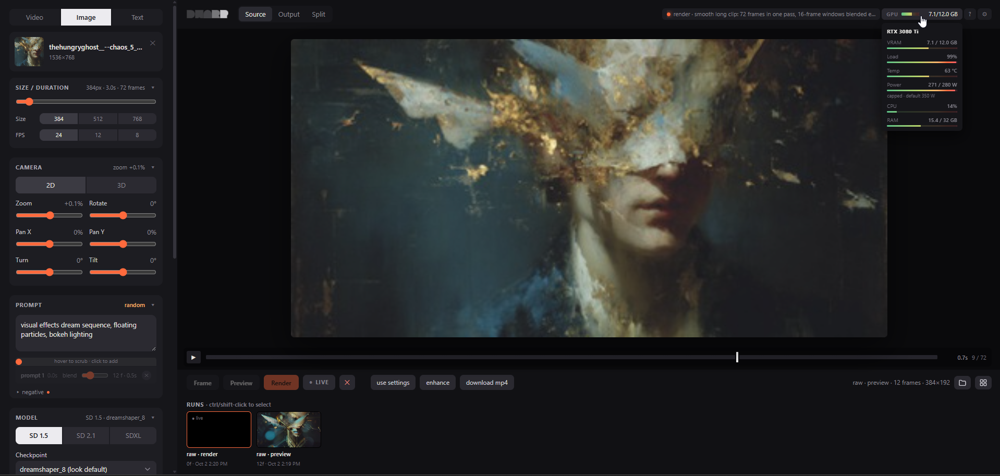

# DWARP

**Diffusion warp** — turn a video into a painted, drawn or dreamed version of itself, frame by frame, locally on your GPU.

DWARP repaints each frame with Stable Diffusion, but instead of starting every frame from scratch it
carries the previous painted frame forward along the video's own motion (optical flow). Brushstrokes
travel with the things they belong to, so the result moves like the footage instead of flickering.

**What sets DWARP apart is DepthDiff**: it doesn't have to repaint everything. Built on spiritform's
[Comfy-DepthDiff](https://github.com/spiritform/Comfy-DepthDiff), a luma or depth map of each frame sets the
denoise *per pixel*, deciding **where** the style goes — keep a face photographic and dissolve the room into
paint, or paint only the shadows. [More below](#depthdiff-choose-where-it-repaints).

One screen: drop a clip, pick a model and a style, write what's in the shot, hit **Frame** or **Preview**.

Everything runs on your own machine, with one opt-in exception: the **Comfy** mode, which runs models far too
big for a desktop card and renders on Comfy Cloud instead. [More below](#h3-a-clip-with-sound-in-the-cloud).

What's new: [CHANGELOG.md](CHANGELOG.md).

## How it works

For every frame:

1. **Flow** — [RAFT](https://github.com/princeton-vl/RAFT) optical flow between the previous and current source frame, both directions.
2. **Warp** — the previous *stylized* frame is pushed forward along that flow.
3. **Trust** — a forward/backward consistency check masks out occlusions, new content and off-screen areas; those fall back to the raw source frame (and get the full Denoise, so the footage doesn't show through). Everywhere else a share of the fresh source is mixed back in (**Source mix**, 15% by default), so paint carried over hundreds of frames levels off instead of overcooking.
4. **Repaint** — img2img from that blend, steered by ControlNets (depth + soft edge) computed on the source frame. The first frame gets the full Denoise; later frames a lower one set by **Frame Lock**, so they refine what's carried forward instead of re-rolling it — high Frame Lock holds on to frame 1's look. With DepthDiff on, Denoise is set per pixel (below).
5. **Colour** — each frame's colour statistics are pulled toward frame 0 to stop feedback drift.

Or switch **Warp** to **Boil**: steps 1–3 are skipped and every frame is repainted from its own source with its own
noise, so the strokes shimmer and redraw like hand-painted animation (*line boil*), while ControlNet keeps them on the
footage.

## DepthDiff: choose where it repaints

DWARP builds in **[DepthDiff](https://github.com/spiritform/Comfy-DepthDiff)** by spiritform — a ComfyUI node that
drives [Differential Diffusion](https://differential-diffusion.github.io/) with a luma or depth map. DWARP ports the
node's mask to its own pipelines (SD 1.5 and SDXL, with or without ControlNet) and runs it on every frame of the clip.

Instead of one Denoise for the whole frame, every pixel gets its own:

- **luma** — the source frame's brightness
- **depth** — its distance, from the same depth map the depth ControlNet uses

The map is shaped with the node's controls: **◐ invert**, **Black / White** levels, **Gamma**, **Contrast**, **Blur**
and **Amount**. White repaints at the full Denoise, black keeps the source, greys fall in between. During sampling
each pixel is held at the source (re-noised to the current step) until its turn comes: white pixels get the whole
schedule, mid-grey ones join halfway, black ones never change.

What it's good for:

- **Keep the subject, dissolve the world** — depth, inverted so the far background repaints and the person stays
- **Paint the shadows** (or the highlights) — luma, so only the dark (or bright) areas take the style
- **Stack it with ControlNet** — ControlNet holds the shapes, DepthDiff picks the areas

The **Diff** tab above the image shows the map live on the source while you drag the sliders — no render needed.

## Shape: a latent mask of your own

DepthDiff takes its map from the footage; **Shape** takes it from you. Drop a black-and-white picture or video on the
Shape card (a colour clip works too: its brightness is the mask) and it becomes a per-pixel mask in the latent, with
the same differential diffusion underneath:

- **Text → Video**: frame 1 is generated from noise only where the mask is white; outside it's held black. An
  animated mask (a circle growing, a wipe, a logo) draws its shape into the render over time.
- **Repaint**: from frame 2 on, white areas keep changing and black ones hold. Where the mask newly spreads is drawn
  fresh, so wipes and reveals come out clean.
- **Levels** (black / midtone / white) turn any footage into a crisp mask, **Blur** softens its edges into a fade,
  **Opacity** makes the whole effect subtler, **◐** swaps which side is the subject.
- **Background** (Text / Image mode): *off* keeps a clean cut-out on black; *on* fills the frame around the shape —
  a generated background in Text mode, your picture in Image mode.
- A filmstrip with **in / out** handles picks the part of a mask video to use (held at Out, or **looped** for animated textures), and the **Shape** tab above the image
  previews it (scrub it, and Frame renders at the mask frame shown).

**Shape library**: the *library* link on the Shape card opens ready-made black / white masks to try, drawn by DWARP itself (no downloads): spirals for the classic QR Code Monster "spiral illusion", rings, sunburst, checker, stripes, waves, halftone and simple shapes, plus seamless loops (turning spirals, rings moving out, a tunnel, shuffling QR-like blocks). Your own masks go in *Yours* (`shapes/yours`).

## Comfy: the one mode that renders somewhere else

Every other mode paints on your own card. The **Comfy** tab sends the job to
[Comfy Cloud](https://www.comfy.org/) instead and brings back the file, which is how DWARP reaches models far
past a 12 GB card. **This is optional and off by default**: without an API key the mode simply says so. With
one, each clip spends Comfy credits and takes a few minutes.

What runs up there is whichever **Workflow** is picked at the top of the Model card. The controls below it
follow that choice — a graph with no reference slots shows no References card, one that writes no audio shows
no Sound switch — because the panel is built from the workflow's own manifest.

**Adding a workflow**: build the graph in ComfyUI, *Workflow → Export (API)*, drop the file in `engine/comfy/`
and add an entry to [`engine/comfy/workflows.json`](engine/comfy/workflows.json) naming which node takes the
prompt, which takes the seed, which carries the size and length, and which node's output *is* the render. The
file documents the full list at the top. No Python.

### H3 · Pika Flex — a clip with sound

The workflow DWARP ships with, and the reason the mode exists. Every other mode repaints *your* frames; H3
doesn't: it reads what you give it and generates a **new** 5–15 s clip that follows what it saw — **with its own
soundtrack**, picture and audio in a single pass. It is the only thing in DWARP that makes audio.

It is [MiniMax-H3](https://huggingface.co/MiniMaxAI) through Pika's
[H3 Flex](https://huggingface.co/Pika-Labs) adapter: a 61 GB transformer plus a 32-billion-parameter text
encoder, which is what puts it out of reach locally.

What goes in:

| | Where it comes from | Call it in the prompt |
|---|---|---|
| **Clip** | the video on the Video tab — the trimmed range, up to 15 s, sound included | `<Video 1>`, `<Audio 1>` |
| **Pictures** | up to nine, in References: click, drop a file, or drag a frame off the stage | `<Picture 1>`, `<Picture 2>` … |

Either is enough on its own. Those tags are how H3 was trained to read references, and it wants a *sectioned
brief* rather than style words — `subject_definitions`, `summary`, `retention_analysis`, `detailed_description`,
`overall_soundscape`, `non_diegetic_music`. **Start from** above the prompt box lays that out for you, filled in
from the clip and references you have loaded, in one of three shapes: a character swap, a full restyle, or a new
scene. With no reference loaded the same briefs leave you a line to describe the style in words instead.
Help → **Comfy** explains the rest.

**Setting it up**: Settings → **Comfy Cloud**, paste a key from
[platform.comfy.org](https://platform.comfy.org/profile/api-keys). It is kept in `config.json`, which is
gitignored, and DWARP never shows it back — Settings only reports whether one is set. Clear it by saving an
empty field. A render needs an active Comfy subscription.

## Features

- SD 1.5, SD 2.1 and SDXL checkpoints — reads your ComfyUI models folder and sorts checkpoints by family from their headers. SD 2.1 reads the original 768-v / 512 `.ckpt` files (converted once, safely, to fp16 safetensors) and has depth + HED ControlNets
- **Embeddings**: drop textual-inversion embeddings (your own trained styles too) into `models/embeddings` and pick one above Style, with its training step; DWARP reads which family each was trained for and lists it in that mode
- Style presets, Denoise (how much it repaints), Frame Lock (how tightly later frames hold frame 1's look), Source mix (how much fresh source each frame gets back) and Hold (how tightly it follows the footage) sliders, sampler + schedule (DPM++ 2M / SDE, Euler, Euler a, UniPC, DDIM, Heun, LCM; Karras, exponential, beta, trailing), steps, CFG, lockable seed
- **Prompt travel**: drop keyframes on the clip's timeline, give each its own prompt; the render morphs from one to the next over a Blend of frames
- **Text → Video**: no video needed, in the spirit of [Deforum](https://github.com/deforum-art/deforum-stable-diffusion)'s animation mode. The prompt paints frame 1, a camera move (zoom, rotate, pan) carries every next frame on from the last, prompt keyframes and Live steer it — the camera too: move its sliders while it renders; set a length, aspect and FPS. Denoise paints frame 1 and Frame Lock sets how much later frames keep, so long runs don't overcook
- **3D camera**: switch the camera to 3D and each frame's MiDaS depth lifts it into space — zoom becomes a dolly, plus turn and tilt, with near things passing faster than far ones (Disco Diffusion's 3D mode)
- **Image → Video**: the same, starting from your picture — frame 1 is the image repainted at your Denoise, and ControlNet / DepthDiff can hold its layout while the style comes in
- **Style ref**: drop a picture and its look steers every frame ([IP-Adapter](https://github.com/tencent-ailab/IP-Adapter)); *style only* borrows colours and strokes without the content ([InstantStyle](https://github.com/instantX-research/InstantStyle)'s style layers). SD 1.5 and SDXL
- **LoRAs**: pick one per render from `models/loras` (or your models folder's, in Settings) with a strength; SD 1.5, SD 2.1 and SDXL, kohya / Stability / diffusers layouts
- **Warp or Boil**: carry the paint along the motion for smooth, sticky strokes, or repaint every frame for the boiling look of hand-painted animation
- **Motion (AnimateDiff)**: a third way next to Warp and Boil (SD 1.5): a motion model paints 16 frames at a time, for smooth, coherent movement. Quality (TemporalDiff for video, AnimateDiff v2 for a picture) or Fast (AnimateLCM, ~2–3× quicker); motion LoRAs and the Camera move a still; Style ref, LoRAs and ControlNet still apply
- **FPS on ones, twos or threes**: render every frame, or every 2nd / 3rd and hold it like hand-drawn animation — half or a third of the render time, and the mp4 still plays at the clip's fps
- **Live**: while a Preview or Render runs, type a prompt and press Enter — the video morphs into it from the frame being rendered, saved as a keyframe
- **[DepthDiff](#depthdiff-choose-where-it-repaints)**: the source's luma or depth decides where the style repaints, per pixel, with a live preview of the map
- **[Shape](#shape-a-latent-mask-of-your-own)**: your own mask picture or video as a latent mask — cut-outs, growing shapes, wipes and transitions, with levels, blur, opacity and in / out
- Seed you can drag left / right to step through nearby ones
- **Frame** renders the frame under the playhead; **Preview** renders 5 frames (every 2nd); **Render** does the trimmed clip. All three render at the chosen Size, so a locked seed starts each on the same picture. Every run fills the stage at the same size
- Source playback, live split view (source / output), a scrubber with clip timecode, live log
- **Runs strip**: every Frame / Preview / Render, newest first. Click one, then **← →** browse runs and **Delete** twice takes the one on show off the strip (the files stay on disk); **use settings** puts a run's settings back in the panel
- **All runs**: a grid of every run on disk, hidden ones too, with sizes — filter by Frames / Previews / Renders, select, hide or show, or delete from disk for good (asked first)
- A built-in guide: the **?** button explains every control
- **[Comfy](#comfy-the-one-mode-that-renders-somewhere-else)** (optional, cloud): runs a ComfyUI graph on Comfy Cloud, picked from a Workflow list you can add to. It ships with MiniMax-H3 / Pika H3 Flex: a 5–15 s clip **with sound** from your footage and reference pictures. Needs an API key; everything else in DWARP stays on your own GPU
- **Enhance**: upscale any finished run with your ESRGAN-family models (via [spandrel](https://github.com/chaiNNer-org/spandrel)) and smooth it with [RIFE](https://github.com/hzwer/Practical-RIFE) or [FILM](https://github.com/google-research/frame-interpolation) frame interpolation (FILM downloads on first use)
- **Refine**: a diffusion upscale — render a finished run again (1× for a second pass, or 1.5× / 2× bigger) with a low Denoise and your prompt, held to its frames by a tile ControlNet and carried along by the warp. Big frames are painted in overlapping tiles, so detail comes out at the scale the model was trained at and VRAM stays flat

## Requirements

- Windows 10/11 with an NVIDIA GPU: 8 GB+ VRAM for SD 1.5, 12 GB recommended for SDXL
- ~6 GB of disk for DWARP itself (PyTorch + CUDA), plus your models

## Install

1. Download or clone this repo.
2. Double-click **`install.bat`**. It sets everything up inside the folder: its own Python,
   PyTorch with CUDA, ffmpeg if you don't have it, and the RIFE weights. It asks once where
   your models are. Press Enter to use DWARP's own `models` folder, or paste a ComfyUI `models`
   folder to reuse what you already have.
3. Models download by themselves the first time a render needs them: the default checkpoint of each
   family, the ControlNets, QR Code Monster and the Motion models, each checked against its SHA-256. The
   panel says beforehand what a first render will fetch and how big it is. To use your own checkpoints,
   or to download ahead of time, see **[models/README.md](models/README.md)**.
4. Double-click **`run.bat`**. DWARP opens at http://localhost:8013.

Re-running `install.bat` is safe: finished steps are skipped. Every download is pinned and
checked against its SHA-256.

## Credits

Based on the work of **Alex Spirin ([Sxela](https://github.com/Sxela))**, who pioneered this technique with [DiscoDiffusion-Warp](https://github.com/Sxela/DiscoDiffusion-Warp), [WarpFusion](https://github.com/Sxela/WarpFusion) and [VibeWarp](https://github.com/Sxela/VibeWarp) ([Patreon](https://www.patreon.com/sxela)). DWARP is an independent re-implementation and contains none of their code.

- [Stable Diffusion](https://github.com/CompVis/stable-diffusion), [ControlNet](https://github.com/lllyasviel/ControlNet) (Lvmin Zhang), [diffusers](https://github.com/huggingface/diffusers), [controlnet_aux](https://github.com/huggingface/controlnet_aux)
- [SD 2.1 ControlNets](https://huggingface.co/thibaud/controlnet-sd21) (thibaud): depth and HED edges
- Text → Video and its 3D camera follow the animation modes of [Deforum](https://github.com/deforum-art/deforum-stable-diffusion) and [Disco Diffusion](https://github.com/alembics/disco-diffusion); depth by [MiDaS](https://github.com/isl-org/MiDaS)
- [IP-Adapter](https://github.com/tencent-ailab/IP-Adapter) (Tencent AI Lab) and [InstantStyle](https://github.com/instantX-research/InstantStyle) (InstantX) for the style ref
- Refine's tiling follows [Ultimate SD Upscale](https://github.com/Coyote-A/ultimate-upscale-for-automatic1111); tile ControlNets by Lvmin Zhang (SD 1.5) and xinsir (SDXL Union ProMax)
- [RAFT](https://github.com/princeton-vl/RAFT) (Teed & Deng) via torchvision
- [ZipDepth](https://github.com/fabiotosi92/ZipDepth) (Fabio Tosi et al.), the light depth option; inference code as packaged by [ComfyUI-ZipDepth](https://github.com/Hullabalo/ComfyUI-ZipDepth) (Hullabalo)
- Motion: [AnimateDiff](https://github.com/guoyww/AnimateDiff) (Guo et al.) and its v2 camera LoRAs, [TemporalDiff](https://huggingface.co/CiaraRowles/TemporalDiff) (Ciara Rowles), [AnimateLCM](https://github.com/G-U-N/AnimateLCM) (Fu-Yun Wang et al.); smooth long clips: [FreeNoise](http://haonanqiu.com/projects/FreeNoise.html) (Haonan Qiu et al.), via diffusers
- [RIFE](https://github.com/hzwer/Practical-RIFE) (hzwer); model code vendored from [ComfyUI-Frame-Interpolation](https://github.com/Fannovel16/ComfyUI-Frame-Interpolation) (MIT, see `vendor/LICENSE-rife`)
- [FILM](https://github.com/google-research/frame-interpolation) (Google Research, Reda et al., Apache-2.0); TorchScript port by [dajes](https://github.com/dajes/frame-interpolation-pytorch)
- [spandrel](https://github.com/chaiNNer-org/spandrel) for loading upscale models
- **[Comfy-DepthDiff](https://github.com/spiritform/Comfy-DepthDiff)** (spiritform) — the luma / depth mask behind DepthDiff, ported from the ComfyUI node
- [Differential Diffusion](https://differential-diffusion.github.io/) (Levin & Fried)
- The wordmark is set in [Alien Block](https://github.com/koci-design/AlienBlock) (OFL, see `vendor/fonts`)
- Page animation: [anime.js](https://animejs.com) by Julian Garnier (MIT, `vendor/anime.min.js`)

## License

MIT — see [LICENSE](LICENSE).
